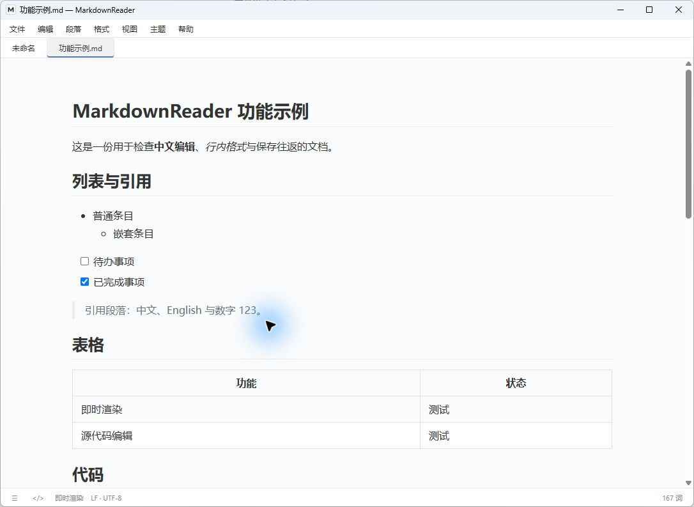

# MarkdownReader


使用 **Go + Wails + Vditor** 构建的 Windows 桌面 Markdown 编辑器，提供即时渲染、源码编辑和便携运行。

当前版本：**0.1.0 Preview 2**。主要功能已实现并经过本机验证，仍处于预览阶段，暂不承诺与 Typora 完全一致。

[下载 Windows x64 便携预览版](https://github.com/wangwc18/MarkdownReader/releases/tag/v0.1.0-preview.2) · [源码与重建方法](RECOVERY.md)

## 背景介绍

Typora在这个年代竟然收费！那现在我可要想想办法了，老实敲代码很枯燥吧，Codex启动！

## UI效果



## 功能

- **编辑**：即时渲染与源码模式、常用格式、表格、代码高亮、撤销重做。
- **文档管理**：多标签、多窗口、文件树、大纲、快速打开、查找替换和文件夹搜索。
- **扩展语法**：本地公式、Mermaid 图表、任务列表、脚注及常见 Markdown 扩展。
- **图片**：本地与剪贴板图片、相对路径、图片目录规则、复制与移动、自定义上传程序。
- **导出**：PDF、PNG、HTML、Word、EPUB 等格式，可配置 Pandoc 和自定义转换命令。
- **阅读与输入**：主题、专注模式、打字机模式、字数统计、英文拼写与基础个人词典。
- **文件保护**：自动保存、草稿恢复、编码选择和保存失败保护。

功能细节见 [使用文档](docs/README.md)，已知限制见 [当前状态](docs/STATUS.md)。

删除本地工程或换机器前，请先阅读 [备份与恢复](RECOVERY.md)。

## 使用便携版

1. 将便携 ZIP 解压到有写入权限的目录。
2. 运行 `MarkdownReader.exe`。
3. 按 `Ctrl+O` 打开文档，或将 Markdown 文件拖到程序 EXE 上。

便携包自带固定版本 **WebView2** 和 **Pandoc**，使用时无需安装 Go、Node.js 或 Pandoc。请保留随包目录结构：

```text
MarkdownReader/
├── MarkdownReader.exe
├── runtime/          # WebView2 运行时
├── tools/            # Pandoc
├── licenses/         # 第三方许可
├── examples/         # 示例文档和资源
└── data/             # 首次启动后创建，保存配置和恢复数据
```

编辑器、公式和图表资源从本地加载；网络图片和上传服务仍需要网络。目标平台为 Windows 10/11 x64，干净系统与普通用户环境的完整验证尚未完成。

## 常用快捷键

| 操作 | 快捷键 |
| --- | --- |
| 新建 / 打开 / 保存 | `Ctrl+N` / `Ctrl+O` / `Ctrl+S` |
| 关闭当前文档标签 | `Ctrl+W`，或点击标签上的 `×` |
| 另存为 | `Ctrl+Shift+S` |
| 切换源码模式 | `Ctrl+/` |
| 查找 / 替换 | `Ctrl+F` / `Ctrl+H` |
| 插入链接 / 表格 | `Ctrl+K` / `Ctrl+T` |
| 侧边栏 | `Ctrl+Shift+L` |
| 新建窗口 | `Ctrl+Shift+N` |
| 专注 / 打字机 / 全屏 | `F8` / `F9` / `F11` |

## 从源码构建

构建环境：**Windows x64、Go 1.26.1、Node.js 24 和 npm**。

在项目根目录执行：

```powershell
# 下载并校验便携依赖，首次构建需要联网
.\scripts\setup-deps.ps1

# 安装前端依赖、运行测试、构建程序并打包
.\scripts\build.ps1 -Package
```

程序输出到 `build/bin/`，便携 ZIP 输出到 `dist/`。仅构建程序时省略 `-Package`；源码包可通过 `.\scripts\package-source.ps1` 生成。

依赖由 `go.mod`、`go.sum`、`frontend/package-lock.json` 锁定。`third_party/go-webview2` 保存导出和开发工具所需的本地补丁，Lute 补丁由 `scripts/patch-lute.mjs` 重复应用。

## 项目结构

```text
main.go              启动入口与前端资源嵌入
internal/desktop/    桌面后端、文件服务及对应 Go 测试
frontend/src/        编辑界面、渲染和前端测试
scripts/             构建、打包和测试辅助程序
third_party/         修改后的第三方源码
docs/                使用说明与开发记录
examples/            示例文档和资源
licenses/            第三方许可证与版权材料
```

依赖缓存、构建产物、运行数据和本地历史归档不提交 Git。便携 ZIP 适合作为 GitHub Release 附件分发。

## 第三方组件与许可

主要组件包括 Wails、Vditor、MathJax、Mermaid、nspell 和英语词典。完整材料见 [第三方说明](licenses/THIRD_PARTY_NOTICES.md) 与 `licenses/`。

Pandoc 作为独立程序调用，来源为 [Pandoc 3.12.1](https://github.com/jgm/pandoc/releases/tag/3.12.1)。WebView2 使用 Microsoft 固定运行时，遵循其分发条款。本项目自身的许可证尚未指定。
